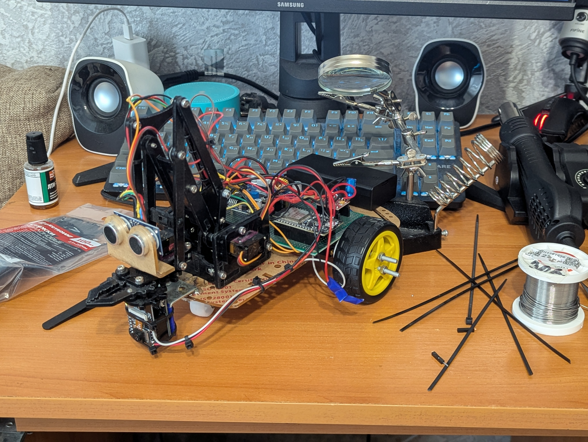
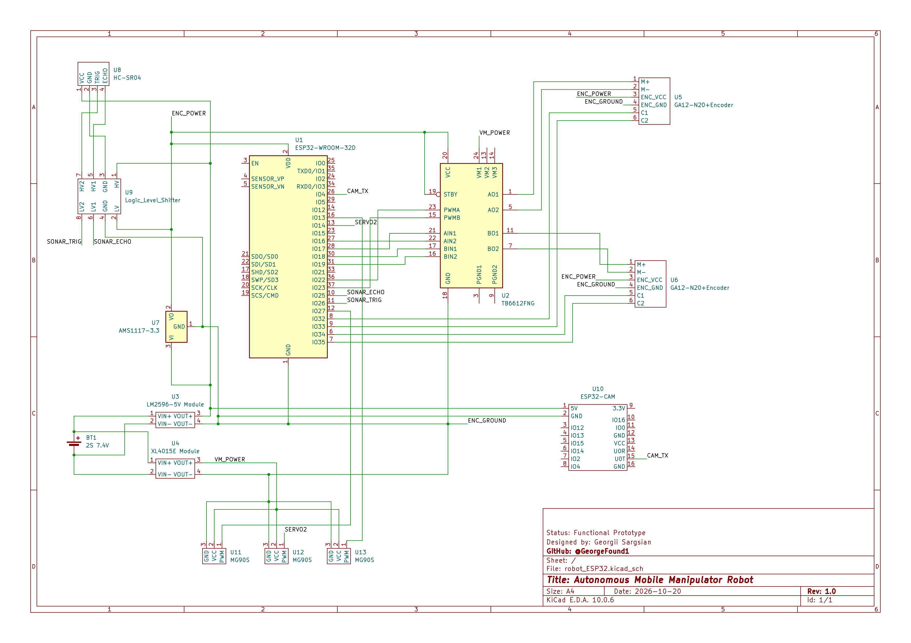

# Autonomous Mobile Manipulator Robot on ESP32

An autonomous mobile robot based on ESP32 with computer vision (ESP32-CAM), wheel odometry, and an inverse kinematics (IK) robotic arm. The robot can detect a target object, calculate the trajectory, approach it, grab it with the claw, and autonomously return to the starting base coordinates (0, 0).

---

##  Demo & Media

* **Full Video Demonstration:** [Watch Video on Google Drive](https://drive.google.com/file/d/1sEtgqUoITEAZFkwgrSwq3bQ-XaOTG2Tg/view?usp=drive_link)

### Robot Gallery
| Front View |
| :---: |
| 

---

##  Key Features

* **Computer Vision Subsystem (ESP32-CAM):**
  * Custom RGB color segmentation algorithm that runs directly on the ESP32-CAM without external servers.
  * Calculates real-time distance and horizontal angle using the camera FOV (60°) and object dimensions.
  * Exponential smoothing filter ($\alpha = 0.8$) to reduce measurement noise.
  * Sends data packets over UART at 115200 baud with a start byte (`0xAA`) and XOR checksum validation.

* **3-DOF Robotic Arm with Analytical Inverse Kinematics:**
  * Uses TowerPro MG90S metal-gear micro servos controlled via native ESP32 `ledc` hardware PWM (14-bit resolution at 50 Hz) without third-party servo libraries.
  * Analytical 2D Inverse Kinematics (IK) based on the law of cosines to automatically calculate shoulder and elbow angles.
  * Built-in safety limits for servo angles and smart height compensation if the shoulder reaches its mechanical minimum limit.
  * Smooth multi-step joint interpolation to prevent mechanical jerk and current spikes.

* **Differential Drive & Odometry:**
  * Powered by two DC gearmotors with magnetic quadrature encoders handled by hardware interrupts (`IRAM_ATTR`).
  * Real-time dead reckoning odometry tracking global coordinates $(x, y)$ and heading angle $\theta$.
  * Closed-loop PID controller (`Kp=7.5, Ki=0.09, Kd=0.25`) for straight driving and wheel speed synchronization.
  * Smooth deceleration when approaching the target (`TARGET_SLOW_DISTANCE`).

* **Obstacle Avoidance & Sensor Filtering:**
  * Non-blocking ultrasonic distance measurement (HC-SR04) using input change interrupts.
  * 5-sample median filter to remove false ultrasonic echoes.
  * Smart sensor muting: ultrasonic readings are ignored while carrying an object so the claw is not detected as an obstacle.

* **Autonomous Mission State Machine:**
  * Snake / wall-following search algorithm when no target is in sight.
  * Staged target approach with course corrections during movement.
  * Camera stabilization delay (5 seconds) before grabbing to eliminate chassis wobble.
  * Automatic backup maneuver if the robot stops too close to the object ($< 9.5\text{ cm}$).
  * Multi-attempt realignment (`MAX_REALIGN`) to center the gripper right before grabbing.
  * Autonomous return to initial home coordinates $(0.0, 0.0)$.

---

##  Hardware & Electronics

The schematic was designed in **KiCad**.

[](docs/schematic.pdf)

### Hardware Components
* **Microcontrollers:**
  * Main Controller: ESP32
  * Vision Module: ESP32-CAM (Ai-Thinker)
* **Actuators & Drivers:**
  * Motor Driver: TB6612FNG Dual H-Bridge
  * Motors: 2x GA12-N20 DC gearmotors with Hall-effect quadrature encoders
  * Arm Servos: 3x MG90S metal-gear servos (Shoulder, Elbow, Claw)
* **Sensors & Logic:**
  * Ultrasonic Sensor: HC-SR04
  * Logic Level Shifter (5V $\leftrightarrow$ 3.3V) for sonar signals
* **Power Management:**
  * Power Source: 2S Li-ion battery (7.4V)
  * LM2596 Step-Down Module: Steps down battery voltage to regulated 5V for microcontrollers and sensors
  * XL4015E Step-Down Module: High-current regulator dedicated to servo motors (`VM_POWER`) to prevent voltage drops and microcontroller reboots

---

##  Software Architecture

The project is split into two separate firmwares:

1. **Vision Node (`vision_board`):**
   * Continuously captures frames from the OV2640 sensor.
   * Scans pixel rows and columns for target color thresholds[cite: 9].
   * Packages object status, estimated distance, and angle into a binary struct and sends it over UART[cite: 8].

2. **Main Controller (`motor_board`):**
   * `protocol.hpp / get_data.cpp`: Unpacks and verifies UART packets using XOR checksum[cite: 1, 8].
   * `interrupts.cpp`: Handles high-speed encoder pulse counters and sonar echo timing[cite: 2].
   * `movement.cpp / movement.hpp`: Runs the odometry equations, PID wheel speed balancing, turning routines, and coordinate navigation (`goToCoords`)[cite: 5, 7].
   * `manipulator.cpp / manipulator.hpp`: Solves 2D inverse kinematics, checks physical joint limits, and drives servos via hardware PWM channels[cite: 4].
   * `main.cpp`: Manages overall robot behavior, transitions between searching, staged approaching, alignment, object lifting, and returning home[cite: 3].

---

##  Getting Started

### Prerequisites
* [VS Code](https://code.visualstudio.com/) with [PlatformIO IDE](https://platformio.org/) (or Arduino IDE with ESP32 board support)
* USB-to-UART programmer (for ESP32-CAM) and standard USB-C cable (for main ESP32)

### Calibration & Configuration
Before running the robot, check the physical dimensions in `motor_board/src/manipulator.hpp`:
* `L1`: Shoulder link length in cm[cite: 4].
* `L_FOREARM`: Forearm link length in cm[cite: 4].
* `L_CLAW`: Claw length to the center of the grip[cite: 4].
* `CAM_TO_SHOULDER_OFFSET`: Horizontal distance between camera lens and shoulder axis[cite: 4].
* `REACH_OFFSET`: Fine-tuning reach offset to adjust grip depth[cite: 4].

### Flashing
1. **Flash ESP32-CAM:**
   * Open `vision_board/`.
   * Connect `GPIO0` to `GND` to enter flashing mode.
   * Upload code via USB-UART adapter and disconnect `GPIO0`.
2. **Flash Main Controller:**
   * Open `motor_board/`.
   * Connect ESP32 via USB-C and upload the project.

---

##  Repository Structure

```text
├── README.md
├── docs/                         # documents, photos, schematic и e.t.c.
├── MyRobot.code-workspace
├── motor_board/                  # ESP32: motors, manipulator, sonar and other
│   ├── platformio.ini
│   └── src/
│       ├── get_data.cpp
│       ├── interrupts.cpp
│       ├── interrupts.hpp
│       ├── main.cpp
│       ├── manipulator.cpp
│       ├── manipulator.hpp
│       ├── movement.cpp
│       ├── movement.hpp
│       ├── pin_modes.hpp
│       ├── protocol.hpp
│       ├── target_search.cpp
│       └── target_search.hpp
└── vision_board/                 # ESP32-CAM: camera and data sending
    └── platformio.ini
    └── src/
        ├── camera_config.cpp
        ├── camera_config.hpp
        ├── camera_processing.cpp
        ├── camera_processing.hpp
        ├── main.cpp
        ├── protocol.hpp
        └── set_data.cpp